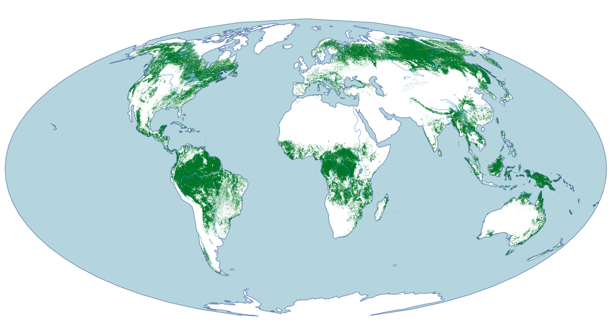

# Natural Forests of the World

**A 2020 baseline for deforestation and degradation monitoring.**

Paper:
[Natural forests of the world](https://www.nature.com/articles/s41597-025-06097-z)

<div style="text-align:center">
    <figure>
        <br>
        <figcaption>
          <strong>Natural forests of the world 2020 (primary and secondary
          naturally regenerating).</strong>
        </figcaption>
    </figure>
</div>

## Overview

Protecting biodiversity and curbing carbon emissions from deforestation demands
a deeper understanding of global forest cover. Informed decision-making requires
not only knowing where forests are, but understanding their composition.
Identifying and distinguishing natural forests plays a critical role, serving as
biodiversity hotspots and major carbon sinks.

In a collaboration between [Google DeepMind](https://deepmind.google/),
the [World Resources Institute (WRI)](https://www.wri.org/), and
[Google Geo Sustainability](https://earthoutreachonair.withgoogle.com/), we have
developed a novel approach to map natural forests globally. We used a semantic
segmentation deep learning model based on a multi-modal, multi-temporal vision
transformer trained on Sentinel-2 satellite imagery.

The resulting **Global Natural Forest Map for 2020** provides a comprehensive
baseline for monitoring deforestation and guiding conservation efforts,
supporting initiatives like the
[European Union's Deforestation Regulation (EUDR)](https://environment.ec.europa.eu/topics/forests/deforestation/regulation-deforestation-free-products_en).

The globally consistent map represents the estimated probabilities of natural
forest presence, enabling nuanced analysis and regional adaptation for
decision-making.

[View the map in Google Earth Engine](https://nature-trace.projects.earthengine.app/view/natural-forests-2020).

### Data characteristics

*   **Baseline year:** 2020
*   **Resolution:** 10-meter spatial resolution
*   **Spatial extent**: Global
*   **Temporal extent**: The `2020_v1_0` version estimates the natural forest
    confidence score for the year 2020.
*   **Bands** (`uint8`):
    *   Band 1: Confidence score (pseudo-probability) of the **Natural forest**
        class, scaled to `[0-250]`.

## Definitions

We align with the Food and Agriculture Organization (FAO) class definitions:

*   **Forest:** Land spanning more than 0.5 hectares with trees higher than 5
    meters and a canopy cover of more than 10%, or trees able to reach these
    thresholds in situ. It does not include land that is predominantly under
    agricultural or urban land use.

*   **Natural forest:** A forest that is a natural ecosystem in terms of species
    composition, structure, and ecological function. This includes the following
    sub-definitions:

    *   **Primary forests:** Forests with no major human impact in recent
        history.
    *   **Naturally regenerating secondary forests:** Forests where the
        ecosystem has attained much of the structure and function of natural
        ecosystems. Note that this definition includes managed natural forests
        and partly degraded forests, provided they have not been converted to
        other land uses, like plantations.

## Data access

The dataset is openly available for research and non-commercial use.

*   **Google Earth Engine (GEE):**

    *   **Collection:** [`projects/nature-trace/assets/forest_typology/natural_forest_2020_v1_0_collection`](https://developers.google.com/earth-engine/datasets/catalog/projects_nature-trace_assets_forest_typology_natural_forest_2020_v1_0_collection)
    *   **Interactive app:** [View the map in GEE App](https://nature-trace.projects.earthengine.app/view/natural-forests-2020)

*   **Direct download (GeoTIFFs):**

    *   **Google Cloud Storage:** `gs://forest_typology/natural_forest_2020_v1_0`
    *   **Figshare:** [https://doi.org/10.25452/figshare.plus.28881731](https://doi.org/10.25452/figshare.plus.28881731)

The data is provided as Cloud Optimized GeoTIFFs (COGs) in Universal Transverse
Mercator (UTM) projection. The pixel values represent the confidence score or
quantized probability values of the **Natural forest** class, scaled to the
range `0-250` (uint8). To get the estimated probability, `[0, 1]`, convert the
integer values to floats and divide the pixel value by 250.

## Usage notes

The dataset provides probabilities to support flexible decision-making.

*   **Recommended threshold:** A probability threshold of **0.52** yielded the
    highest overall accuracy (92%) in our global validation.

*   **Custom thresholds:** Users can adjust the threshold (for example,, between
    0.30 and 0.55) to prioritize either user's accuracy (fewer false positives)
    or producer's accuracy (capturing more forest), depending on the specific
    region and application.

## Citing this work

If you use this dataset in your work, cite the following paper:

> Neumann, M., Raichuk, A., Jiang, Y., Rey, M., Stanimirova, R., Sims, M. J.,
> ... & Purves, D. (2025). Natural forests of the world – a 2020 baseline for
> deforestation and degradation monitoring. *Scientific Data*, 12(1), 1715.
> https://doi.org/10.1038/s41597-025-06097-z

**BibTeX:**

```
@article{neumann2025natural,
  title={Natural forests of the world -- a 2020 baseline for deforestation and degradation monitoring},
  author={Neumann, Maxim and Raichuk, Anton and Jiang, Yuchang and Rey, M{\'e}lanie and Stanimirova, Radost and Sims, Michelle J and Carter, Sarah and Goldman, Elizabeth and Anderson, Keith and Poklukar, Petra and others},
  journal={Scientific Data},
  volume={12},
  number={1},
  pages={1715},
  year={2025},
  publisher={Nature Publishing Group},
  doi={10.1038/s41597-025-06097-z},
  url={https://doi.org/10.1038/s41597-025-06097-z}
}
```

## License and disclaimer

Copyright 2025 DeepMind Technologies Limited

All non-software materials are licensed under the Creative Commons Attribution
4.0 International License (CC-BY). You may obtain a copy of the CC-BY license
at: https://creativecommons.org/licenses/by/4.0/legalcode

Unless required by applicable law or agreed to in writing, all software and
materials distributed here under the Apache 2.0 or CC-BY licenses are
distributed on an "AS IS" BASIS, WITHOUT WARRANTIES OR CONDITIONS OF ANY KIND,
either express or implied. See the licenses for the specific language governing
permissions and limitations under those licenses.

This is not an official Google product.
